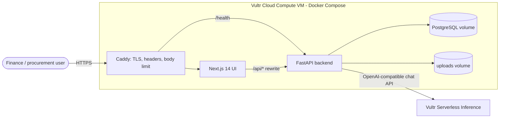

# Architecture

## Principle: rules decide, the LLM explains and extracts

| Concern | Who does it | Where |
|---|---|---|
| Quote scoring and ranking (price 50%, lead time 30%, rating 20%) | Deterministic Python | `app/scoring.py` |
| Approval gate (`total > APPROVAL_REQUIRED_OVER_USD`) | Deterministic Python | `services/procurement.py` |
| PO amounts | `quantity x unit_price` from the chosen quote, `Decimal` | `services/procurement.py` |
| Three-way match, tolerances, flags | Deterministic Python | `app/matching.py` |
| Status changes and their audit rows | One state-machine function | `app/state_machine.py` |
| Reading an invoice into fields | LLM, validated by Pydantic | `app/extraction.py` |
| Per-quote rationale text, exception summaries | LLM, with deterministic template fallback | `services/*.py` |

The LLM never sets an amount, a flag, a rank or a status. Its only inputs to money logic are extracted invoice fields, which the rules then check (total arithmetic, PO price/quantity, duplicates, confidence).

## Treating LLM output as untrusted

- `llm.chat_json` requests JSON, parses it, validates against a Pydantic schema, retries once with the validation error, then raises `LLMError`.
- Schemas clamp or reject out-of-range values (confidence clamped to 0-1; negative totals, empty line items, malformed currency rejected).
- On failure the invoice becomes `needs_review` (nothing is guessed) and matching flags `LOW_CONFIDENCE`; rationale and summary text fall back to labelled templates (`rationale_source` / `exception_summary_source` = `template`).
- Invoice text is wrapped in `<invoice_document>` tags, the system prompt declares it untrusted data, and any attempt to close the tag is stripped. Independently, a regex detector flags documents that address an AI (`SUSPICIOUS_CONTENT`). Exception-summary prompts are built from rule output only, never raw invoice text.

## State machines (`app/state_machine.py`)

Request: `open -> quoted -> compared -> awaiting_approval | approved -> po_created`, with `rejected` reachable before approval.
Invoice: `uploaded -> extracted | needs_review -> matched | flagged -> approved -> paid`, with `rejected` from matched/flagged/needs_review.

`transition()` rejects illegal moves (HTTP 409) and writes the `AuditLog` row in the same transaction.

## Data model

`Vendor`, `PurchaseRequest`, `Quote`, `PurchaseOrder`, `Invoice`, `Payment` (simulated), `AuditLog`. Money columns are `Numeric`; amounts travel as decimal strings in the API.

## API surface

Procurement: `POST /procurement/requests`, `GET /procurement/requests[/{id}]`, `POST .../{id}/quotes|compare|approve|reject`.
Invoices: `POST /invoices/upload`, `GET /invoices[/{id}]`, `POST /invoices/{id}/match|decision`.
Ops: `GET /dashboard/summary`, `/approvals`, `/audit`, `/audit/facets`, `/vendors`, `/health`.
Interactive docs at `/docs` on the backend (not exposed publicly by Caddy, which only forwards `/health` to the backend).
